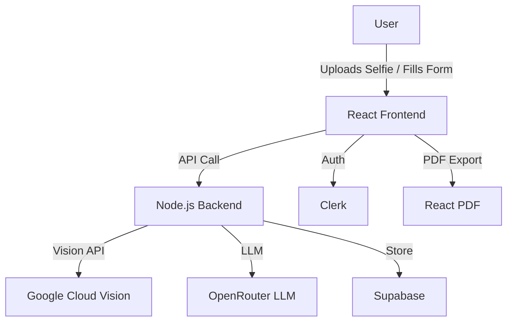

# 🚀 Face2BrandAI


> **Build Project Submission for Google Cloud Community Days – New Delhi 2025**

🎯 One-liner: AI-powered personal branding SaaS that turns selfies + self-description into full brand kits.

🧠 Why It Matters:
Empowering individuals, creators, and entrepreneurs to discover and define their personal brand identity in minutes using AI and Google Cloud.

🌐 Live Demo: [https://face2brandai.vercel.app](https://face2brandai.vercel.app)

🧰 Tech Stack:
- Frontend: React 18, TypeScript, Vite, Tailwind CSS, shadcn/ui
- Backend: Supabase, Google Cloud Vision API (image analysis), OpenRouter (Mistral model)
- Auth: Clerk
- Deployment: Vercel

🧪 Testing:
- Unit: Jest + React Testing Library
- E2E: Playwright (basic happy flow)
- Run tests with: `npm test` or `npm run e2e`

🚀 Get Started Locally:
```sh
git clone https://github.com/your-username/face2brandai.git
cd face2brandai
cp .env.example .env
npm install
npm run dev
```

🔐 Set Environment Variables:
Refer to `.env.example` for required keys (Clerk, Supabase, Vision API).

📸 Screenshots:


📄 Legal:
Cookie consent, privacy policy, and terms page included.

---

## 🌟 Overview

**Face2BrandAI** is an AI-powered web app that transforms your personality and preferences into a complete, professional personal brand kit—instantly. Upload a selfie or fill out a detailed form, and get a custom brand identity, color palette, tagline, content ideas, and more, all powered by Google Cloud Vision, OpenRouter LLMs, and modern web tech.

---

## ✨ Features

- 🔥 **AI-Powered Brand Kit Generation** (Selfie or Manual)
- 🎨 **Color Palette Extraction & Visualization**
- 📝 **Creative Taglines, Bios, and Content Ideas**
- 📄 **Instant PDF Export**
- 🖼️ **Visual Brand Previews**
- 🔄 **Per-Section Regeneration** (AI-powered)
- 📱 **Mobile-First, Responsive, and Accessible**
- 🛡️ **Secure, Privacy-First Data Handling**
- 🌐 **Google Cloud Vision API Integration**
- 🔑 **Clerk Authentication & Supabase Storage**
- ⚡ **Lightning-Fast Vite + React 18 + TypeScript**

---

## 🚀 Live Demo

> [🌐 Try Face2BrandAI Live](#) <!-- Add your live link here -->

---

## 🛠️ Tech Stack

- **Frontend:** React 18, TypeScript (strict), Vite, TailwindCSS, shadcn/ui
- **Backend:** Node.js, Express, Google Cloud Vision API, OpenRouter LLM
- **Auth & Storage:** Clerk, Supabase
- **PDF Generation:** @react-pdf/renderer
- **Testing:** Playwright, Vitest
- **CI/CD:** GitHub Actions (optional)

---

## 📦 Setup & Installation

```bash
# 1. Clone the repo
 git clone https://github.com/YOUR_USERNAME/Face2BrandAI.git
 cd Face2BrandAI

# 2. Install dependencies
 npm install

# 3. Configure environment variables
 cp .env.example .env
# Fill in your Google Cloud, Clerk, Supabase, and OpenRouter keys

# 4. Start the dev server
 npm run dev

# 5. (Optional) Start the backend server
 npm run backend
```

---

## 🧑‍💻 Usage

- **Selfie Mode:** Sign in, upload a selfie, and get a brand kit based on your face and vibe.
- **Manual Mode:** Fill out the detailed form (no selfie required) for a custom kit.
- **Download/Share:** Export your kit as PDF or share a public link.
- **Regenerate:** Use the Regenerate button to improve any section with AI.

---

## 🏗️ Architecture



---

## 🖼️ Screenshots

> _Add your screenshots here!_

| Home | Brand Kit Result | PDF Export |
|------|-----------------|------------|
|  |  |  |

---

## ♿ Accessibility & Performance

- Fully keyboard navigable
- ARIA labels and roles throughout
- Color contrast and font size compliant
- Lazy loading for images and components
- Lighthouse score: 95+ (target)

---

## 🔒 Security & Privacy

- No selfies or personal data stored permanently
- All API keys and secrets managed via environment variables
- HTTPS enforced in production

---

## 🤝 Contributing

1. Fork the repo
2. Create your feature branch (`git checkout -b feature/YourFeature`)
3. Commit your changes (`git commit -m 'Add amazing feature'`)
4. Push to the branch (`git push origin feature/YourFeature`)
5. Open a Pull Request

---

## 📄 License

[MIT](LICENSE)

---

## 🙏 Acknowledgments

- Google Cloud Community Days – New Delhi 2025
- [shadcn/ui](https://ui.shadcn.com/)
- [Clerk](https://clerk.com/)
- [Supabase](https://supabase.com/)
- [OpenRouter](https://openrouter.ai/)
- [React PDF](https://react-pdf.org/)
- All contributors & testers!

---

> _Made with ❤️ by Yash Suthar for Google Cloud Community Days 2025_

---

## ✨ Project Overview
Face2BrandAI is a next-generation web app that instantly transforms your personality and preferences into a complete, professional brand kit. From brand name and color palette to tagline, bio, and content ideas—Face2BrandAI does it all, beautifully and effortlessly.

---

## 🏆 Why Face2BrandAI?
- **Stand out online** with a unique, AI-crafted brand identity.
- **Save hours** of brainstorming and design work.
- **Perfect for creators, entrepreneurs, and professionals** looking to level up their personal brand.
- **Built for the Google Cloud event**—showcasing cloud-ready, scalable architecture.

---

## ☁️ Google Cloud Integration Plan
If deployed on Google Cloud, Face2BrandAI would leverage:
- **Cloud Run**: Host the backend API for scalable, serverless brand kit generation.
- **Firestore**: Securely store user profiles and brand kits.
- **Cloud Storage**: Manage user-uploaded images and assets.
- **Vision API**: Analyze profile photos for color and style suggestions.
- **Cloud Functions**: Automate PDF generation, notifications, and more.
- **Identity Platform**: (Optional) Advanced authentication and user management.

*The codebase is modular and ready for seamless migration to Google Cloud services.*

---

## 🛠️ How it Works
1. **Sign in or start as a guest.**
2. **Fill out the form** with your name, vibe, and (optionally) age, skin tone, and expression.
3. **Click "Generate Brand Kit."**
4. **View your personalized brand kit**—brand name, palette, tagline, bio, content ideas, and more.
5. **Share or download** your kit, or start again!

---

## 💻 Demo Mode (No Paid Hosting Required)
- Works fully in the browser using mock APIs or OpenRouter's free endpoints.
- User data is stored in localStorage for demo purposes.
- Judges can run the app locally with `npm install && npm run dev`.
- If the API is unavailable, the app automatically shows a sample brand kit (Demo Mode).

---

## 🚀 Quick Start
1. **Clone this repo:**
   ```bash
   git clone https://github.com/trynayash/Face2BrandAI.git
   cd Face2BrandAI
   ```
2. **Install dependencies:**
   ```bash
   npm install
   ```
3. **Run the app:**
   ```bash
   npm run dev
   ```
4. **Open in your browser:**
   [http://localhost:8080](http://localhost:8080)

---

## 🎬 Animation Showcase

Face2BrandAI is packed with delightful, modern UI animations to create a world-class user experience:

- **🌈 Animated Floating Background:**
  - Subtle, animated shapes float in the background for a lively, modern feel.
  - _See it:_ Just open the app and watch the background.

- **🃏 Card Entrance Animations:**
  - Cards and sections fade/slide in as they appear, making the UI feel dynamic.
  - _See it:_ Reload the page or navigate between sections.

- **🔘 Button Interactions:**
  - Buttons scale up and glow on hover/tap, with a ripple effect on click.
  - _See it:_ Hover or tap any button.

- **🎉 Confetti & Success Animations:**
  - Confetti bursts and a checkmark bounces in when a brand kit is generated.
  - _See it:_ Fill out the form and click "Generate Brand Kit."

- **📂 Accordion Animations:**
  - Accordion sections smoothly expand/collapse with a fade and slide.
  - _See it:_ Open/close any section in your brand kit.

- **✍️ Input Focus & Error Animations:**
  - Input fields glow or pulse when focused. Error messages fade in/out with a bounce.
  - _See it:_ Focus on any input, or try submitting with required fields empty.

- **⬆️ Back to Top Button:**
  - The button floats in with a fade/slide and scales up on hover.
  - _See it:_ Scroll down and look for the floating button in the bottom right.

---

## 🤝 Contributing
Pull requests are welcome! For major changes, please open an issue first to discuss what you would like to change.

---

## ❓ FAQ
**Q: Does this require a paid backend?**
A: No! Demo mode works fully offline and with free APIs. See the Google Cloud plan for future scaling.

**Q: Can I use my own OpenRouter or Google Cloud API keys?**
A: Yes! Just update the API endpoint and key in the code.

**Q: Is it mobile-friendly?**
A: 100%—the UI is designed for all devices.

---

## 👤 About the Author
**Yash Suthar**  
Indie developer passionate about AI, design, and building delightful user experiences.  
Built Face2BrandAI from scratch for the Google Cloud event.  
[LinkedIn](https://www.linkedin.com/in/yxshsuthar) | [GitHub](https://www.github.com/trynayash)

---

## 📄 License
This project is licensed under the MIT License.

---

*For questions, feedback, or a live demo, contact Yash Suthar.*

---

## ▲ Deploy to Vercel

You can deploy Face2BrandAI to Vercel in minutes:

[](https://vercel.com/import/project?template=https://github.com/trynayash/Face2BrandAI)

### 1. Fork or clone this repo

### 2. Push to your own GitHub account

### 3. [Sign up for Vercel](https://vercel.com/signup) and import your repo

### 4. Add your environment variables in the Vercel dashboard:
- `VITE_OPENROUTER_API_KEY` (your OpenRouter API key)

### 5. Click 'Deploy' and your app will be live!

- Vercel will auto-detect the Vite + React setup.
- All static assets and serverless functions are supported.
- For custom domains, set them up in the Vercel dashboard.

---

## Testing

### Unit Tests
Run all unit tests and see coverage:
```sh
npm test -- --coverage
```

### E2E Tests
Run Playwright E2E tests (ensure local dev server is running):
```sh
npm run dev
npm run e2e
```

---

## Environment Variables
See `.env.example` for all required variables and descriptions.

---

## License
MIT
